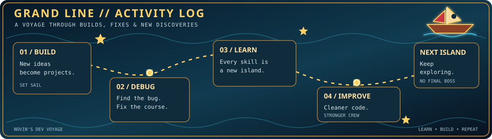
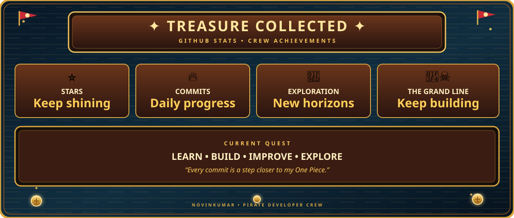

  <!-- ONE PIECE HEADER -->
  

  

   

  <!-- PROFILE COUNTERS -->
  <table align="center">
    <tr>
      <td align="center">
        
      </td>
      <td align="center">
        
      </td>
    </tr>
  </table>

   

  <!-- SOCIAL LINKS -->
  
  
  

---

<!-- ABOUT ME -->
<h2 align="center">👋 About Me</h2>

<table align="center" width="100%">
  <tr>
    <td width="60%" valign="top">

### 🚀 What I Do

I'm a developer focused on building clean, functional web applications. I enjoy solving problems, learning new technologies, and continuously improving my craft.

- 🎯 **Currently:** Sharpening my Full Stack skills
- 🛠️ **Building:** Side projects and practical applications
- 📖 **Learning:** Advanced React patterns and system design
- 💬 **Open to:** Collaboration and tech discussions

    </td>
    <td width="40%" valign="top">

### ⚡ Quick Facts

| | |
|---|---|
| 🌍 **Based in** | India |
| 💻 **Role** | Developer |
| 🎮 **Downtime** | One Piece and gaming |
| ☕ **Fuel** | Coffee and consistency |
  </tr>
</table>

---

---

<!-- ONE PIECE PORTFOLIO -->
<h2 align="center">☠️ My Grand Line Portfolio</h2>

  

    <i>Every great developer begins with a dream. Mine sets sail on the Grand Line!</i>
  

  

    

  

    

  <i>"I'm gonna be King of the Devs!"</i>

---

<!-- STATUS -->

  
  
  

    

  <i>💭 "It's your will that shapes your fate — no matter how small or weak you are." — One Piece</i>

---

<!-- GITHUB BOUNTY BOARD -->
<h2 align="center">⚓ GitHub Stats — Bounty Board</h2>

  YOUR JOURNEY • YOUR CODE • YOUR ADVENTURE

  <table align="center" width="100%">
    <tr>
      <td align="center" width="50%" valign="middle">
        
      </td>
      <td align="center" width="50%" valign="middle">
        
      </td>
    </tr>
    <tr>
      <td align="center" colspan="2" valign="middle">
         
        
          
      </td>
    </tr>
  </table>

---

<!-- ACTIVITY VOYAGE -->
<h2 align="center">🌊 The Grand Line — Developer Activity</h2>

  BUILD • DEBUG • LEARN • LEVEL UP

  

---

<!-- TREASURE BOARD -->
<h2 align="center">🏆 Treasure Collected</h2>

  EVERY SKILL UNLOCKED IS ANOTHER TREASURE

  

---

<!-- CONTRIBUTION SNAKE -->
<h2 align="center">🐍 The Legendary Sea Snake</h2>

  MY GITHUB CONTRIBUTION JOURNEY

  

---

<!-- TECH STACK -->
<h2 align="center">⚔️ Devil Fruit Powers — Tech Stack</h2>

  <h3>💻 Languages & Frameworks</h3>

  

  <h3>🛠️ Tools & Databases</h3>

  

---

<!-- ONE PIECE QUOTES -->
<h2 align="center">📜 Words from the Grand Line</h2>

  > "I don't want to conquer anything. I just think the guy with the most freedom in this whole ocean... is the Pirate King!"
  >
  > — Monkey D. Luffy

   

  > "It's your will that shapes your fate — no matter how small or weak you are!"
  >
  > — Portgas D. Ace

   

  > "When do you think people die? When they are shot through the heart by a bullet? No. It's when they are forgotten."
  >
  > — Dr. Hiluluk

---

<!-- JOIN MY CREW -->
<h2 align="center">🤝 Join My Crew</h2>

  
  

    

  <b>⚔️ BUILD &nbsp; • &nbsp; 🧭 EXPLORE &nbsp; • &nbsp; 🔥 LEVEL UP</b>

    

  <i>"I'm gonna be King of the Devs!"</i>

    

  

  <b>Thanks for sailing through my profile!</b>

   

  Leave a ⭐ like a Vivre Card to find your way back! 🧭

